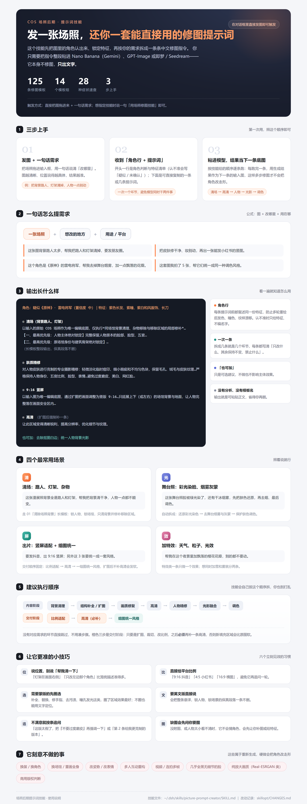

# picture-prompt-creator · 场照后期提示词技能

> 发一张漫展场照 + 一句话需求，先认出角色、锁定特征，再输出可直接粘贴进 **Nano Banana（Gemini）/ GPT-Image / 即梦 · Seedream** 的中文修图指令。
> 它只产出**文字提示词**，不修图——修图交给图生图模型。

一份给 COS 场照后期用的「技能」文件：`SKILL.md`。任何支持读图与长上下文的 AI agent（DeepSeek Harness、Claude Code、Cursor 等）加载后即可按统一流程工作。

| 指标 | 数值 |
| --- | --- |
| 提示词模板 | **125** 条 |
| 模板分组 | **14** 组（清场 / 扩图 / 画质 / 边缘 / 肤质妆容 / 发型 / 身材 / 服装 / 道具 / 特效 / 光影 / 调色 / 平台适配…） |
| 症状速查 | **28** 行「症状 → 优先模板」表 |
| 文件体积 | 约 30,745 字符 / 1,022 行 |

---

## 快速开始

1. **把场照发给支持读图的 agent**，附一句话需求。例：
   > 这张漫展照背景全是路人和灯架，帮我把背景清干净，人物一点都不能变。
2. **拿到输出**：第一行是角色判断与特征清单（认不准会写「疑似 / 未确认」），下面是可直接复制的一条或多条提示词。
3. **粘进图生图模型**，把「只改什么 / 其余保持不变 / 禁止什么」整段贴进去；生成结果作为下一条的输入图，逐条推进。

## 输出示例

```text
角色：疑似《原神》· 雷电将军（置信度 中）｜特征：紫色长发、紫瞳、紫白和风服饰、长刀

① 清场（背景路人、灯架）
以输入的原始 COS 场照作为唯一编辑底图，仅执行"同场馆背景清理、杂物移除与移除区域的局部修补"。
【一、最高优先级：人物主体绝对锁定】完整保留人物原本的脸部、脸型、五官…
【二、最高优先级：原场馆身份与建筑骨架绝对锁定】…

② 肤质精修
对人物皮肤进行克制的专业摄影精修：轻微淡化临时痘印、细小瑕疵和不均匀色块，
保留毛孔、绒毛与皮肤纹理…避免过度磨皮、美白、网红脸…

③ 高清（扩图/适配后必补）
让此区域变得清晰锐利，提高分辨率，优化细节与纹理。

也可加：去除抠图白边；统一人物背景光影
```

## 它能做什么

**流程（一~三节）**：使用流程 → 角色识别与特征锁定 → 输出规则（含 Nano Banana / GPT-Image / 即梦 的平台差异）。

**症状速查（第四节）**：背景路人、舞台烟雾灰蒙、手机广角畸变、舞台彩光染色、闪光灯硬阴影、脱妆汗渍、闭眼表情僵、眼镜反光、LED 频闪横纹、背景水印与隐私信息、抠图黑白边、双下巴、亮片水钻、丝袜网袜、道具悬空、发光武器、竖屏比例、扩图后发软、组图风格不统一……

**模板组（六节索引，共 14 组）**

<details>
<summary>展开 14 组清单</summary>

- 01 核心整图流程（清除场照背景、扩图补全）
- 02 背景与穿帮清理
- 03 扩图、补全与场景结构（含校正广角与镜头畸变、背景人群虚化）
- 04 画质修复与清晰度（含去灯光光斑/鬼影、去频闪横纹）
- 05 边缘与抠图痕迹（含去背景文字水印与隐私打码）
- 06 肤质与妆容（含还原舞台彩光染色、修硬光阴影、修脱妆、眼镜反光）
- 07 发型与假发
- 08 身材与体态（含下颌线与双下巴）
- 09 服装与布料材质（含亮片水钻、纹身彩绘、丝袜网袜、羽毛毛领）
- 10 道具与武器材质（含发光道具、纸质卷轴）
- 11 场景特效与氛围（含舞台激光、特效妆、瞳孔发光）
- 12 光影、融合与景深（含去舞台烟雾与灰蒙）
- 13 调色与输出
- 14 平台适配与批量一致性（竖屏比例、一组图统一风格）

</details>

**组合配方（七节）** 11 条现成流程；**通用骨架 / 通用负面（八、九节）** 可套任意自定义需求；**变量与约定（五节）** 15 行，含角色名、特征清单、比例、安全区、色彩基准、指定主体等。

## 使用技巧

- **说位置**：「灯架在画面右侧」「只改左边那个角色」比「帮我清一下」准得多。
- **直接给平台比例**：9:16 抖音、4:5 小红书、16:9 横图，省一轮追问。
- **需要蒙版的先圈选**：补全、替换、修手指、去污渍、瞳孔发光等，圈了区域效果最好。
- **要英文版直接说**：会整条意译，锁人物、锁场景的保真段落一条不删。
- **按条追问**：「第 2 条太假了，把『不要过度磨皮』再强调一下」。
- **处理顺序**：背景清理 → 结构补全/扩图 → 画质修复 → 高清 → 人物精修 → 光影 → 调色 → 比例适配 → 高清（必补）→ 组图统一风格。

## 它刻意不做的事

换装 / 换角色 / 换场馆 / 重画全身、大改姿势或表情、多人互动重构、视频与连拍多帧、严重遮挡或全黑无信息的脸、纯超分放大器、商用版权判断——这些属于重新生成，硬做会让角色身份漂移。

## 可视化说明书

长图（建议点开看原图）：



也可以在浏览器打开单页版：[docs/manual.html](docs/manual.html)（自带打印样式，可直接存 PDF）。

## 安装 / 加载

- **DeepSeek Harness**：把 `SKILL.md` 放到 `~/.dsh/skills/picture-prompt-creator/SKILL.md`。若技能在磁盘上却提示 `not available for model invocation`，检查 `~/.dsh/skills-manager/state.json` 中 `sources.dsh` 是否为 `true`。
- **Claude Code**：放到 `~/.claude/skills/picture-prompt-creator/SKILL.md`（`name` / `description` frontmatter 已按通用格式写好）。
- **其他 agent**：直接把 `SKILL.md` 全文作为系统提示或指令文件挂载即可，不依赖任何工具调用。

## 仓库结构

```text
SKILL.md          # 技能本体（frontmatter + 九节说明 + 125 条模板）
CHANGES.md        # 优化记录：结构对比、内容改动、质检修正、仍不覆盖的场景
docs/manual.html  # 可视化说明书（单页 HTML，可打印）
docs/manual.png   # 同上，长图版
```

## 版本记录

见 [CHANGES.md](CHANGES.md)。要点：102 → 125 条模板；新增角色识别 / 症状速查 / 平台差异 / 组合配方；两轮独立冒烟与逐条校验（每条正文唯一出现、索引全覆盖、frontmatter 可解析）。

## License

未声明。如需开源协议（MIT / CC BY 4.0 等），欢迎提 issue 或直接改这个仓库。
